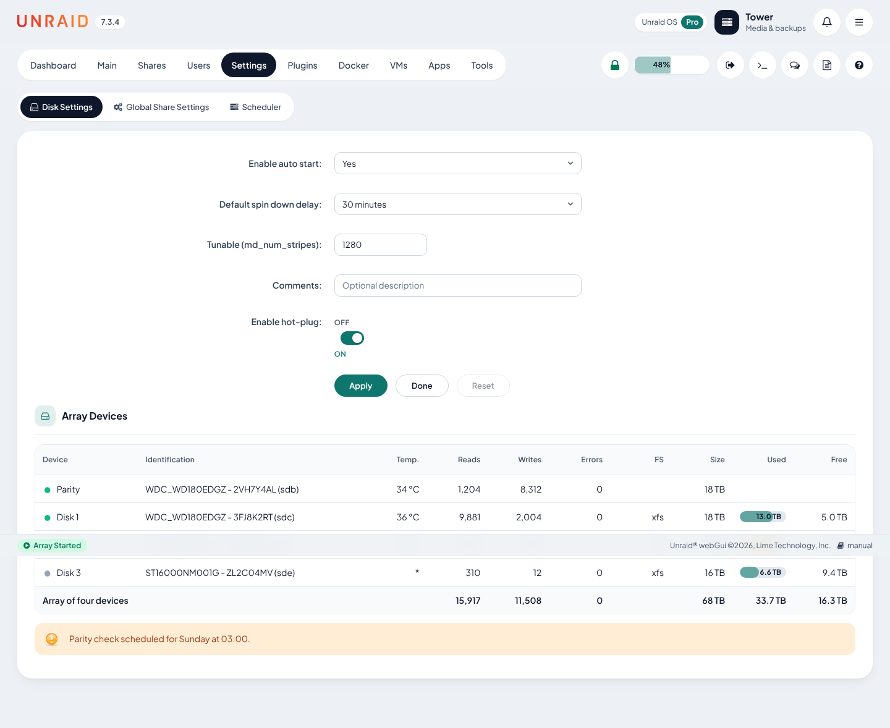

# Glacier Theme pour Unraid

Un thème clair et moderne pour le webGUI d'Unraid 7.3 : fond bleu-gris doux, cartes blanches très arrondies, menu en pilule, accent sarcelle et police Plus Jakarta Sans.


| Réglages | Formulaire et tableau des disques |
| --- | --- |
|  |  |

## Installation

1. Dans Unraid : **Plugins → Install Plugin**, coller cette adresse, puis **Install** :

   ```
   https://raw.githubusercontent.com/R0m1k3/Glacier-Theme/main/Glacier-Theme.plg
   ```

   En SSH : `plugin install https://raw.githubusercontent.com/R0m1k3/Glacier-Theme/main/Glacier-Theme.plg`
2. Dans **Settings → Display Settings**, choisir le thème Dynamix **White**.

Le `.plg` contient tous les fichiers du thème, polices comprises : une fois le fichier récupéré, l'installation ne télécharge rien d'autre. Les mises à jour apparaissent ensuite dans la page **Plugins** d'Unraid.

Sans accès internet, copiez `Glacier-Theme.plg` dans `/boot/config/plugins/` (partage `flash`, dossier `config/plugins`) puis installez-le avec ce chemin, ou redémarrez le serveur.

**Aurora Theme** : désinstallez-le avant. Les deux thèmes restylent les mêmes éléments et ne doivent pas tourner ensemble.

## Réglages

Dans **Settings → User Utilities → Glacier Theme** :

- **Theme** : active ou désactive le thème.
- **Accent colour** : la couleur des boutons de validation, liens, interrupteurs, icônes et barres. Laissez vide pour garder le sarcelle. Le texte sur les boutons passe tout seul au blanc ou au foncé selon la couleur choisie.
- **Dashboard greeting card** : affiche ou masque la carte d'accueil au-dessus des tuiles du tableau de bord.

## Ce que le thème change

- **Couleurs et police** : palette Glacier sur toutes les variables du thème White d'Unraid, et Plus Jakarta Sans embarquée (aucune requête externe).
- **En-tête** : sur le fond de page plutôt qu'en bandeau noir. Le nom du serveur s'affiche derrière une pastille sombre, et les boutons sont ronds et blancs. Une bannière éventuelle devient un bandeau arrondi.
- **Menu** : barre blanche en pilule, onglet actif en foncé, actions rapides en boutons ronds, collé en haut au défilement.
- **Pages** : contenu sur une carte blanche, onglets en contrôle segmenté, titres de section avec l'icône dans un carré teinté, pages Réglages et Outils en tuiles.
- **Tableau de bord** : chaque tuile devient une carte, avec son icône dans un carré teinté et des boutons ronds. La carte d'accueil reprend le nom du serveur, l'état de l'array et l'uptime, mis à jour en direct.
- **Formulaires** : champs et listes arrondis avec un anneau de focus, interrupteurs en pilule, boutons en pilule (validation dans la couleur d'accent), rangées de boutons sur une ligne.
- **Tableaux** : coins arrondis, lignes fines, en-tête discret et survol des lignes. Les barres d'utilisation sont arrondies.
- **Dialogues, menus, infobulles, avis et pied de page** : harmonisés, avec l'état de l'array en pastille dans le pied de page.
- **Téléphone** : le menu défile horizontalement, les actions passent à la ligne et l'en-tête se simplifie.

## En cas de problème

- Ajoutez `?glacier=off` à n'importe quelle adresse (par exemple `/Dashboard?glacier=off`) pour couper le thème dans ce navigateur. `?glacier=on` le remet.
- Pour vos retouches, `/boot/config/plugins/Glacier-Theme/custom.css` et `custom.js` sont chargés après le thème.
- Pour désinstaller : **Plugins**, ou `plugin remove Glacier-Theme.plg` en SSH.

## Limites connues

- **Thème clair uniquement** : le thème ne s'applique qu'avec Dynamix White. Avec Black, Azure ou Gray, Unraid reste tel quel.
- Les couleurs personnalisées d'en-tête de Display Settings ne sont pas reprises.
- Les composants Vue d'Unraid (en-tête, notifications) sont restylés à partir de leur structure en 7.3.x. Une future version d'Unraid pourra demander des ajustements.
- La page de connexion n'est pas modifiée.

## Développement

Les sources sont dans `plugin/src/` :

| Fichier | Rôle |
| --- | --- |
| `GlacierTheme.page` | Injecté dans le `<head>` de chaque page ; charge le thème si le thème Dynamix est White |
| `GlacierThemeSettings.page` | Page de réglages |
| `styles/glacier.css` | Le thème |
| `scripts/glacier.js` | Carte d'accueil du tableau de bord |
| `fonts/` | Plus Jakarta Sans (SIL OFL 1.1) |

Générer le plugin :

```
python3 plugin/build.py            # écrit Glacier-Theme.plg (version = date et heure)
```

Pour publier une mise à jour : modifier les sources, relancer `build.py`, puis commiter et pousser `Glacier-Theme.plg` sur `main`. Unraid compare la version du fichier en ligne avec celle installée.

Banc de test visuel : des pages de maquette qui reprennent la structure HTML d'Unraid 7.3.4, rendues avec les vraies feuilles de style d'Unraid, avec et sans Glacier, sur ordinateur et téléphone :

```
git clone --depth 1 --branch 7.3.4 https://github.com/unraid/webgui.git /tmp/webgui
node test/render.mjs /tmp/webgui    # captures dans test/shots/
```

## Licence

MIT, voir [LICENSE](LICENSE). Plus Jakarta Sans est sous SIL Open Font License 1.1 (`plugin/src/fonts/plus-jakarta-sans-LICENSE.txt`). Le mécanisme d'injection s'inspire d'[Aurora Theme](https://github.com/Tunefish92/Aurora-Theme) (MIT).
