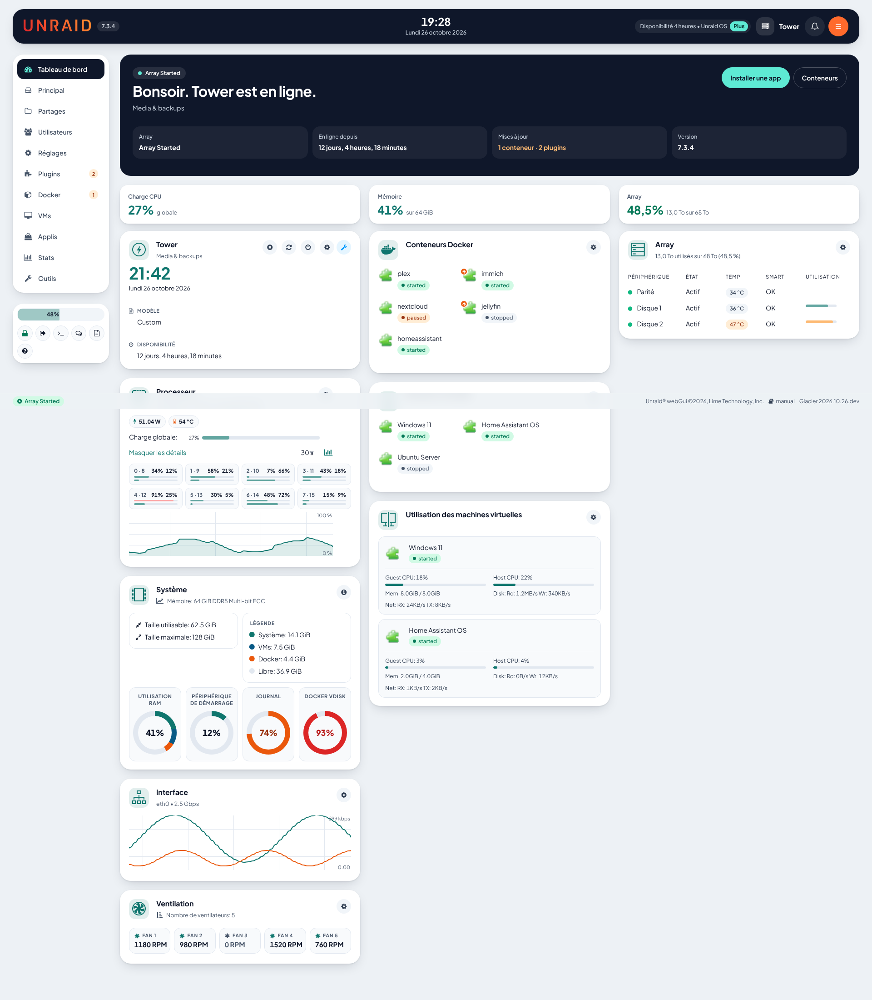
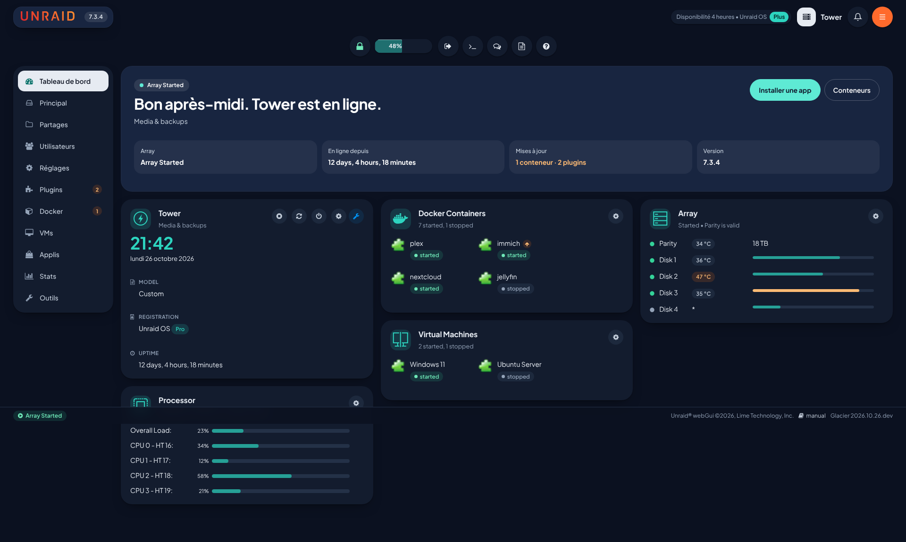
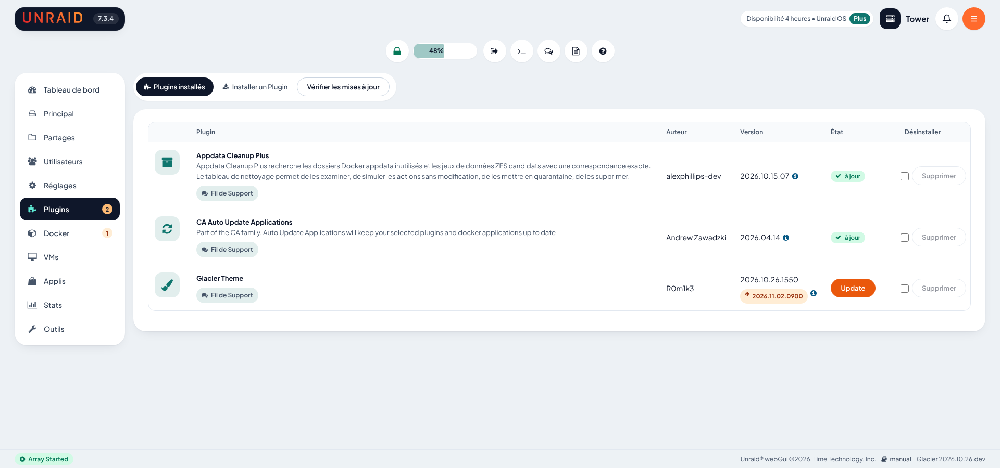
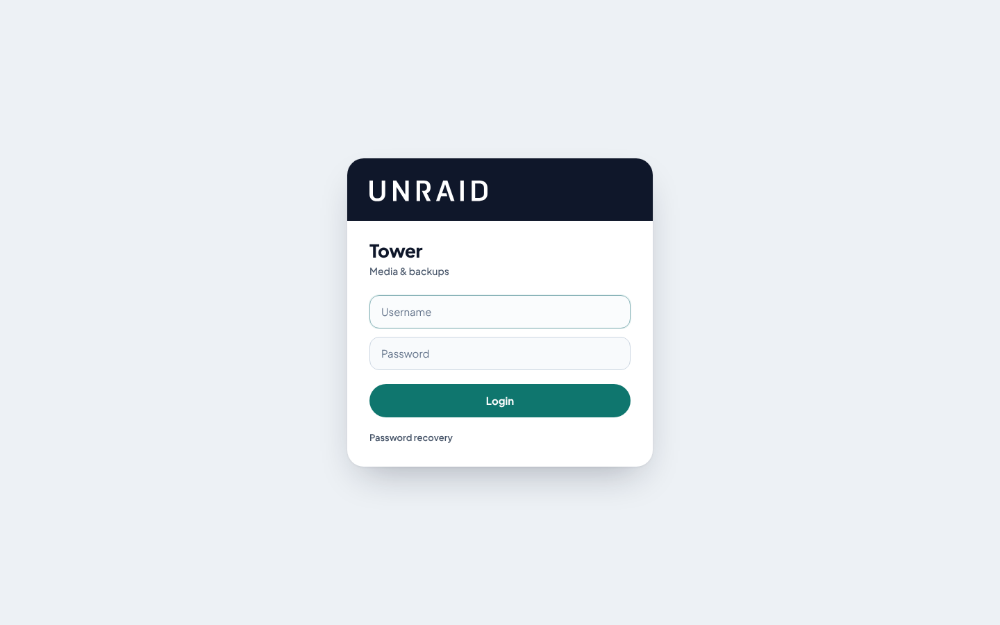
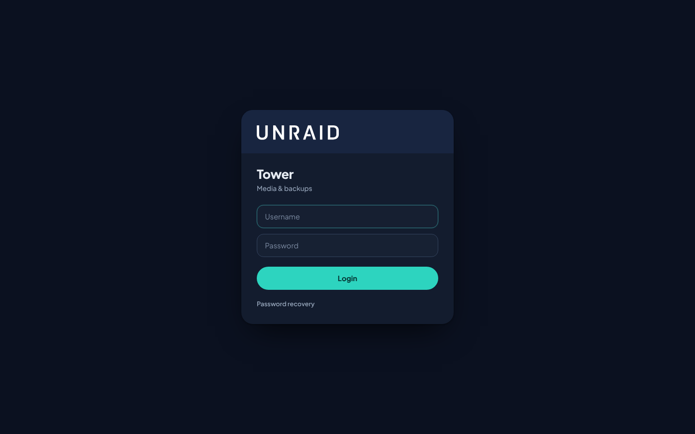
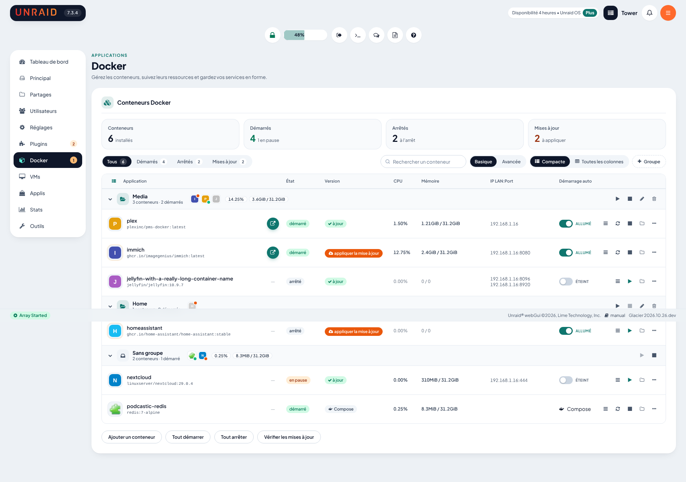
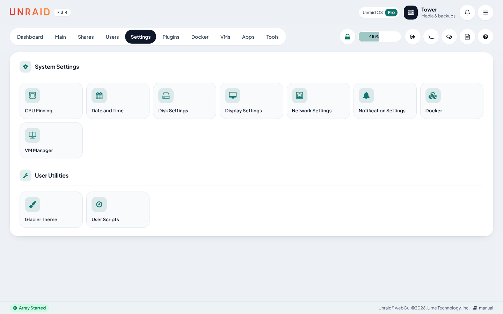

# Glacier Theme pour Unraid

Un thème moderne, clair ou sombre, pour le webGUI d'Unraid 7.3 : fond bleu-gris doux, cartes blanches très arrondies, menu en pilule, accent sarcelle et police Plus Jakarta Sans.



| Mode sombre | Plugins |
| --- | --- |
|  |  |

| Connexion | Connexion (sombre) |
| --- | --- |
|  |  |

| Docker | Réglages |
| --- | --- |
|  |  |

## Installation

1. Dans Unraid : **Plugins → Install Plugin**, coller cette adresse, puis **Install** :

   ```
   https://raw.githubusercontent.com/R0m1k3/Glacier-Theme/main/Glacier-Theme.plg
   ```

   En SSH : `plugin install https://raw.githubusercontent.com/R0m1k3/Glacier-Theme/main/Glacier-Theme.plg`
2. Dans **Settings → Display Settings**, choisir le thème Dynamix **White** (Glacier clair) ou **Black** (Glacier sombre).

Le `.plg` contient tous les fichiers du thème, polices comprises : une fois le fichier récupéré, l'installation ne télécharge rien d'autre. Les mises à jour apparaissent ensuite dans la page **Plugins** d'Unraid.

Sans accès internet, copiez `Glacier-Theme.plg` dans `/boot/config/plugins/` (partage `flash`, dossier `config/plugins`) puis installez-le avec ce chemin, ou redémarrez le serveur.

**Aurora Theme** : désinstallez-le avant. Les deux thèmes restylent les mêmes éléments et ne doivent pas tourner ensemble.

## Réglages

Dans **Settings → User Utilities → Glacier Theme** :

- **Theme** : active ou désactive le thème.
- **Light or dark** : suivre le thème Dynamix (White → clair, Black → sombre), toujours clair ou toujours sombre.
- **Accent colour** : la couleur des boutons de validation, liens, interrupteurs, icônes et barres. Laissez vide pour garder le sarcelle. Le texte sur les boutons passe tout seul au blanc ou au foncé selon la couleur choisie.
- **Dashboard greeting card** : affiche ou masque la carte d'accueil au-dessus des tuiles du tableau de bord.

## Ce que le thème change

- **Mode sombre** : les mêmes cartes et badges en couleurs de nuit, avec l'accent sarcelle plus lumineux.
- **Version** : affichée sur la page de réglages et en pied de page.
- **Couleurs et police** : palette Glacier sur toutes les variables du thème White d'Unraid, et Plus Jakarta Sans embarquée (aucune requête externe).
- **En-tête** : sur le fond de page plutôt qu'en bandeau noir. Le nom du serveur s'affiche derrière une pastille sombre, et les boutons sont ronds et blancs. Une bannière éventuelle devient un bandeau arrondi.
- **Menu** : sur grand écran, une carte à gauche du contenu, avec une icône par entrée et l'entrée active en foncé. Les actions rapides (cadenas, recherche, terminal…) sont en boutons ronds, centrés sous l'en-tête. Sur tablette et téléphone, le menu redevient une barre en pilule.
- **Badges** : états des conteneurs et VMs (démarré, en pause, arrêté), statut des mises à jour et vérifications (Docker, Plugins), températures des disques (orange ou rouge au-delà des seuils de Disk Settings), systèmes de fichiers et type de licence.
- **Mises à jour** : un compteur sur les entrées Docker et Plugins du menu et dans la carte d'accueil, le bouton Update des plugins et le lien « apply update » de Docker en orange. Les chiffres viennent des vérifications faites par Unraid (Check for updates, vérification planifiée), sans appel en ligne.
- **Pages** : contenu sur une carte blanche, onglets en contrôle segmenté, titres de section avec l'icône dans un carré teinté, pages Réglages et Outils en tuiles.
- **Tableau de bord** : chaque tuile devient une carte, avec son icône dans un carré teinté et des boutons ronds. La carte d'accueil reprend le nom du serveur, l'état de l'array et l'uptime, mis à jour en direct.
- **Formulaires** : champs et listes arrondis avec un anneau de focus, interrupteurs en pilule, boutons en pilule (validation dans la couleur d'accent), rangées de boutons sur une ligne.
- **Tableaux** : coins arrondis, lignes fines, en-tête discret et survol des lignes. Les barres d'utilisation sont arrondies.
- **Dialogues, menus, infobulles, avis et pied de page** : harmonisés, avec une comète aux couleurs du thème à la place des trois points verts pendant les opérations, avec l'état de l'array en pastille dans le pied de page.
- **Téléphone** : le menu défile horizontalement, les actions passent à la ligne et l'en-tête se simplifie.

## Améliorations des pages

Plusieurs améliorations sont adaptées d'[Aurora Theme](https://github.com/Tunefish92/Aurora-Theme) (licence MIT, voir [NOTICE.md](NOTICE.md)) et traduites en français :

- **Toutes les pages** : un titre avec une ligne de description en haut de chaque onglet.
- **Tableau de bord** :
  - un bandeau de chiffres clés (CPU, mémoire, array) ;
  - les cœurs du processeur en tuiles ;
  - les graphiques et anneaux aux couleurs du thème ;
  - les ventilateurs et l'utilisation des VMs en cartes ;
  - un badge de mise à jour sur l'icône des conteneurs ;
  - un clic sur un conteneur ouvre une fenêtre avec toutes ses actions.
- **Réglages et Outils** : une recherche (touche `/`) et des favoris avec une étoile, enregistrés dans `/boot/config/plugins/Glacier-Theme/favourites.json`.
- **Utilisateurs** : des cartes avec initiales, rôle et recherche.
- **Principal** : les opérations de l'array en cartes, avec la progression du contrôle de parité.
- **Docker** :
  - un récapitulatif, des filtres et une recherche ;
  - Basique/Avancée en bouton segmenté ;
  - une vue compacte (WebUI, CPU, mémoire, actions), en cartes sur téléphone ;
  - la vérification des ports dans l'éditeur de conteneur.
- **Groupes d'applications** :
  - des sections nommées et repliables pour les conteneurs et les VMs, sur leurs onglets et sur le tableau de bord ;
  - démarrage et arrêt d'un groupe entier.

  Ils sont enregistrés dans `docker-groups.json` et `vm-groups.json`. Déplacer des éléments (cadenas d'Unraid déverrouillé) enregistre aussi l'ordre de démarrage d'Unraid. Si le plugin FolderView est installé, les groupes et le réordonnancement sont désactivés.

## En cas de problème

- Ajoutez `?glacier=off` à n'importe quelle adresse (par exemple `/Dashboard?glacier=off`) pour couper le thème dans ce navigateur. `?glacier=on` le remet.
- Pour vos retouches, `/boot/config/plugins/Glacier-Theme/custom.css` et `custom.js` sont chargés après le thème.
- Pour désinstaller : **Plugins**, ou `plugin remove Glacier-Theme.plg` en SSH.

## Limites connues

- Le thème s'applique avec Dynamix White ou Black. Avec Azure ou Gray, Unraid reste tel quel. En mode forcé (toujours clair ou toujours sombre), les graphiques et panneaux d'Unraid gardent les couleurs du thème Dynamix.
- Les couleurs personnalisées d'en-tête de Display Settings ne sont pas reprises.
- Les composants Vue d'Unraid (en-tête, notifications) sont restylés à partir de leur structure en 7.3.x. Une future version d'Unraid pourra demander des ajustements.
- **Page de connexion** : Unraid la sert avant l'authentification, hors des pages habituelles. L'installation ajoute donc une ligne d'inclusion dans ses deux pages de connexion (`.login.php` et `.set-password.php`, en mémoire). Cette ligne n'agit que si le fichier du thème existe, et la désinstallation la retire. En cas de souci, `/login?glacier=off` rend la page d'origine.

## Développement

Les sources sont dans `plugin/src/` :

| Fichier | Rôle |
| --- | --- |
| `GlacierTheme.page` | Injecté dans le `<head>` de chaque page ; charge le thème si le thème Dynamix est White |
| `GlacierThemeSettings.page` | Page de réglages |
| `styles/glacier.css` | Le thème |
| `scripts/glacier.js` | Carte d'accueil, badges de température et de système de fichiers, compteurs de mises à jour |
| `include/updates.php` | Compte les mises à jour Docker et plugins en attente (cache de 10 minutes) |
| `fonts/` | Plus Jakarta Sans (SIL OFL 1.1) |

Générer le plugin :

```
python3 plugin/build.py            # écrit Glacier-Theme.plg (version = date et heure)
```

Pour publier une mise à jour : modifier les sources, relancer `build.py`, puis commiter et pousser `Glacier-Theme.plg` sur `main`. Unraid compare la version du fichier en ligne avec celle installée.

Banc de test visuel : des pages de maquette qui reprennent la structure HTML d'Unraid 7.3.4, rendues avec les vraies feuilles de style d'Unraid, avec et sans Glacier, sur ordinateur et téléphone :

```
git clone --depth 1 --branch 7.3.4 https://github.com/unraid/webgui.git /tmp/webgui
node test/render.mjs /tmp/webgui    # captures dans test/shots/
```

## Licence

MIT, voir [LICENSE](LICENSE). Plus Jakarta Sans est sous SIL Open Font License 1.1 (`plugin/src/fonts/plus-jakarta-sans-LICENSE.txt`). Le mécanisme d'injection s'inspire d'[Aurora Theme](https://github.com/Tunefish92/Aurora-Theme) (MIT).
